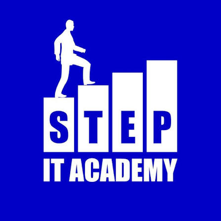

<div align="center">
  

  # Voices Left Behind

  **The mission ended. The evidence did not.**

  An interactive educational story about the NASA hardware that fell silent on the Moon, Mars, and in deep space.

  **NASA Space Apps Challenge 2026 · Team ITSTEP_abuze · Kyiv, Ukraine**

  [Explore the live website](https://voices-left-behind-nasa-2026.vividllama2.chatgpt.site)
</div>

## About the project

**Voices Left Behind** makes space history approachable through a combination of emotional storytelling and verified science. Four real spacecraft and instrument packages are introduced through short imagined first-person lines, followed by accessible mission facts, scientific results, reasons for the end of communication, and links to official NASA sources.

The project responds to the NASA Space Apps Challenge theme **“Abandoned but not Forgotten: A Data and Storytelling Challenge.”** It is designed for students, families, and curious readers without a technical background.

## Featured missions

| Mission | Where | What it left behind |
| --- | --- | --- |
| Apollo 12 ALSEP | Moon | A long-running surface observatory and an archive of lunar measurements |
| InSight | Mars | The first detailed seismic view inside another rocky planet |
| Ingenuity | Mars | Proof that powered, controlled flight is possible on another world |
| Pioneer 10 | Deep space | A pioneering Jupiter mission continuing silently beyond communication range |

## Highlights

- Responsive, single-page experience for desktop and mobile
- Mission filters for the Moon, Mars, and deep space
- Accessible keyboard navigation, skip link, and reduced-motion support
- Full-screen mission image viewer
- Mission timeline and comparison table
- Clear separation between imagined narration and verified facts
- Direct NASA references and image credits
- Transparent AI use disclosure and non-endorsement disclaimer
- Dedicated team section with Telegram contacts

## Team ITSTEP_abuze

We are a five-person student team from **STEP IT Academy in Kyiv, Ukraine**.

| Team member | Telegram |
| --- | --- |
| Олексій Солоха | [@craftle0](https://t.me/craftle0) |
| Георгій Вересенко | [@veruuxxgg](https://t.me/veruuxxgg) |
| Павло Стойчев | [@pavel0x](https://t.me/pavel0x) |
| Тимофій Якобчук | [@yakobchuktimofey](https://t.me/yakobchuktimofey) |
| Тимофій Шарабурін | [@Shartiq](https://t.me/Shartiq) |

## Technology

The site is intentionally lightweight and requires no framework or build step:

- Semantic HTML5
- Modern CSS with responsive layouts and motion preferences
- Vanilla JavaScript
- Google Fonts: Barlow Condensed and Inter

## Run locally

Clone the repository and serve its root directory with any static web server. For example:

```bash
python -m http.server 8080
```

Then open `http://localhost:8080` in a browser. Opening `index.html` directly also works for a quick preview.

## Project structure

```text
Voices-Left-Behind/
├── assets/       # Mission imagery and the team affiliation logo
├── index.html    # Page content and semantic structure
├── styles.css    # Visual system and responsive layouts
├── script.js     # Navigation, filters, reveal effects, and image viewer
└── README.md
```

## Research and image credits

Mission facts were reviewed against official NASA material. Each mission image is credited on the website and linked to its NASA source page. Core references include:

- [Apollo 12 ALSEP](https://science.nasa.gov/image-detail/as12-46-6789-alsep/)
- [InSight](https://science.nasa.gov/mission/insight/)
- [Ingenuity Mars Helicopter](https://science.nasa.gov/mission/mars-2020-perseverance/ingenuity-mars-helicopter/)
- [Pioneer 10](https://science.nasa.gov/mission/pioneer-10/)
- [NASA Space Apps Challenge brief](https://www.spaceappschallenge.org/2026/challenges/nasas-discarded-equipment-storytelling/)

The STEP IT Academy logo was supplied by the project team and is used only to identify the students’ educational affiliation.

## AI use disclosure

OpenAI ChatGPT and Codex supported research organization, English-language editing, web design, development, and debugging. Mission facts were checked against official NASA sources. AI was not used to create scientific data or replace mission evidence.

## Disclaimer

This independent student project was created for the NASA Space Apps Challenge. It is **not an official NASA website** and is not endorsed or sponsored by NASA. NASA names and imagery are used for educational storytelling with source attribution.
